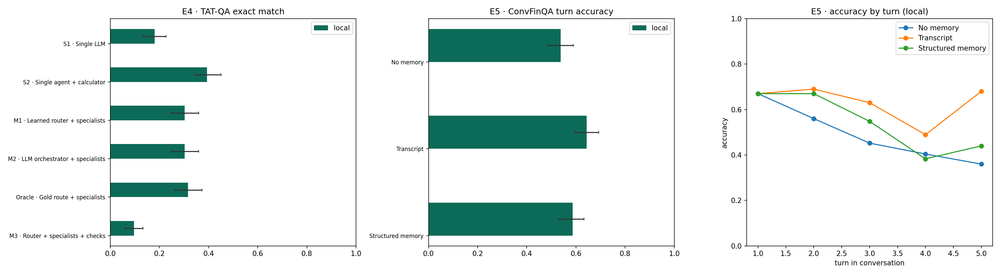

# FinSight AI · Research Part 2: Agents and memory

This branch holds only the Part 2 research experiments for FinSight AI. The application code lives on `main`, Part 1 lives on `research/part-1-grounding-benchmarks`, and the literature review lives on `research/multi-agent-finance-assistants`.

Part 1 chose the building blocks: bge-m3 embeddings for routing and search, and "compute numbers with code, mark them verified when two routes agree". Part 2 asks two questions about **putting the blocks together**:

1. **Agents:** does a router plus specialist agents actually beat one strong agent with tools, and at what cost?
2. **Memory:** which memory design keeps a multi-turn money conversation correct?

Every experiment runs on real public data, with no curated or synthetic examples. Part 2 does not need any files from Part 1; it reuses Part 1's methods, which are built into this notebook.

| File | What it is |
| --- | --- |
| [`part2_agents_and_memory.ipynb`](part2_agents_and_memory.ipynb) | The full experiment notebook, ready to import into Kaggle |
| [`part2_local_gpu.ipynb`](part2_local_gpu.ipynb) | The same notebook with only the local model (GPU session) |
| [`part2_api_cpu.ipynb`](part2_api_cpu.ipynb) | The same notebook with only the API model (no GPU), to run at the same time as the local one |

## Experiments

| Exp | Question | Real dataset | Primary metric |
| --- | --- | --- | --- |
| **E4** | Router + specialists versus a single agent | [TAT-QA](https://github.com/NExTplusplus/TAT-QA): 1,668 dev questions over real annual-report tables and text, needing a copied span, several spans, a calculation or a count | Exact match and F1 from the official TAT-QA scorer, plus LLM calls and tokens per question |
| **E5** | Memory designs for multi-turn conversations | [ConvFinQA](https://github.com/czyssrs/ConvFinQA): 421 dev conversations (1,490 turns) over real S&P 500 earnings reports, where later questions refer back to earlier answers | Accuracy per turn, on follow-up turns, and over whole conversations, plus prompt tokens per turn |

## Technical approach

```
part2_agents_and_memory.ipynb
├── 0  Configuration      sample sizes, models, API settings, FAST switch
├── 1  Setup              packages, output folder, bootstrap CIs, paired bootstrap differences
├── 2  Shared tools       Part 1's sandboxed program runner, number parsing, answer matching
├── 3  LLM backends       local Qwen 2.5 7B (4-bit) and an OpenAI-compatible API, one cache
├── E4 Agents on TAT-QA   learned router → specialists → six arms → official scorer → failure modes
├── E5 Memory on ConvFinQA  three memory designs, turn by turn, using the model's own earlier answers
└── Summary               summary.csv, results.json, summary.png
```

### Two backends, identical prompts

Every LLM arm runs on a **local open model** (Qwen 2.5 7B Instruct in 4-bit, with a 3B fallback; one full copy per GPU, so a T4 x2 session can work through two batches at the same time when `USE_ALL_GPUS = True`, which is off by default because 4-bit models crashed that way on Kaggle) and, when an API key is present, an **API model** (default Gemini 3.5 Flash-Lite on Google's free tier, through its OpenAI-compatible endpoint; Groq or any other OpenAI-compatible provider works). Both use the same system prompt, the same messages and greedy decoding. The API runs on the first part of the same random sample, and the notebook also scores the local model on exactly those questions, so the two backends pair up. Every generation is cached on disk with its prompt and output token counts, so a run stopped by a rate limit continues where it stopped.

### E4 · Agents

| Arm | Design | LLM calls per question |
| --- | --- | --- |
| **S1** · Single LLM | Answers directly after brief reasoning | 1 |
| **S2** · Single agent + calculator | One agent that can call a calculator tool up to 3 times (ReAct style). The strong single-agent baseline every multi-agent arm is compared against | 1–4 |
| **M1** · Learned router + specialists | A bge-m3 + logistic regression router (trained on TAT-QA *train* questions, tested on *dev*) sends the question to a **lookup** specialist (copy spans), a **calculator** specialist (Part 1's reason-then-program) or a **counter** specialist (list items, count in code) | 1 |
| **M2** · LLM orchestrator + specialists | The LLM decides which specialist to call | 2 |
| **M3** · Router + specialists + checks | M1, but a calculated answer is kept only if it agrees with S1, and a copied span only if it appears verbatim in the report; otherwise it abstains | 2 |
| **Oracle** · Gold route + specialists | TAT-QA's gold answer type picks the specialist: the ceiling for any router | 1 |

- All arms see the same report (table plus paragraphs) and the same answer rules, including the scale (thousand, million, percent ...), which the official scorer requires.
- Each specialist runs once per question and the arms are composed from those outputs, so differences come only from the design. Cost per arm counts only the calls that arm would make on its own.
- Each multi-agent arm reports its paired difference from S2 with a 95% bootstrap CI. A multi-agent design only "wins" if that interval is above zero.
- Every wrong answer gets a failure label: wrong route, program failed, right number but wrong scale, sign error, percent versus fraction, wrong number, partial span or wrong span.

### E5 · Memory

| Arm | Memory given at each turn |
| --- | --- |
| **No memory** | Only the current question |
| **Transcript** | Every earlier question with the assistant's own earlier answers, as chat apps do |
| **Structured memory** | A short ledger of earlier results as named variables (`m1 = 60.94  # price per share in 2007`) that the program can use directly, each labelled with the question it answered, like a `memory.md` file. Turn 1 is identical in every arm |

- Every arm answers with Part 1's reason-then-program method and sees ConvFinQA's annotated supporting facts, as Part 1 did with FinQA.
- The assistant's own earlier answers are carried forward, never the gold ones, so mistakes propagate as they would for a real user.
- Reported per arm: accuracy over all turns, on the first turn, on follow-up turns, on turns that reuse an earlier result, and over whole conversations; accuracy on a follow-up after a wrong versus a right previous answer (error carry-over); and prompt tokens per turn. Paired differences between arms come with 95% bootstrap CIs.

### Reference points from the literature

- **TAT-QA:** the dataset paper's TagOp model reaches 58.0% F1 on the test set, against 90.8% for human experts ([Zhu et al., 2021](https://arxiv.org/abs/2105.07624)).
- **ConvFinQA:** the dataset paper reports about 69% execution accuracy for FinQANet (RoBERTa-large), against about 89% for human experts ([Chen et al., 2022](https://arxiv.org/abs/2210.03849)).

These use different splits and setups, so treat them as context. The fair comparisons are between the arms inside this notebook.

## Run it on Kaggle

1. Open [kaggle.com/code](https://www.kaggle.com/code) and choose **New Notebook**.
2. Choose **File → Import Notebook**, then paste this link:
   `https://github.com/Sanskar1724/FinSight_AI/blob/research/part-2-agents-and-memory/part2_agents_and_memory.ipynb`
   If the URL import does not work, download the raw file and upload it instead:
   `https://raw.githubusercontent.com/Sanskar1724/FinSight_AI/research/part-2-agents-and-memory/part2_agents_and_memory.ipynb`
3. In the right panel, set **Accelerator → GPU T4 x2** and **Internet → On**.
4. Optional, for the API comparison: get a free key from [Google AI Studio](https://aistudio.google.com/apikey). In Kaggle, open **Add-ons → Secrets**, add a secret named `LLM_API_KEY` with the key, and tick it for this notebook. Without a key the API backend is skipped and everything else runs.
5. For a quick check, set `FAST = True` in the first code cell and choose **Run All** (about 15–20 minutes).
6. For the real results, set `FAST = False` and use **Save Version → Save & Run All (Commit)**. The local model makes about 3,000 generations: roughly 2–3 hours on one T4, and roughly half that with both T4s (`USE_ALL_GPUS = True`, the default); the API adds about 1.5 hours at 10 requests per minute (about 900 calls).
7. Download the results from the saved version's **Output** tab with **Download Output**.

Free API tiers change their model names and limits often. If the API stops with a rate-limit or quota message, run the notebook again later: finished answers are cached and it continues from there. To use Groq instead, set `API_BASE_URL = "https://api.groq.com/openai/v1/"`, `API_MODEL = "openai/gpt-oss-20b"` and `API_RPM = 5` (its free tier allows only 8,000 tokens per minute). At the start of the run the notebook prints every model your key can use, and warns you if `API_MODEL` is not one of them.

### Settings worth trying

| Setting | Default | Try |
| --- | --- | --- |
| `TATQA_N` / `CONV_N` | 300 questions / 100 conversations | 1668 / 421 for the full dev sets |
| `API_TATQA_N` / `API_CONV_N` | 100 / 30 | Larger if your API limits allow |
| `LLM_NAME` | `Qwen/Qwen2.5-7B-Instruct` in 4-bit | Any instruction-tuned model on Hugging Face |
| `API_MODEL` | `gemini-3.5-flash-lite` (free) | `gemini-3.8-flash` (free, stronger but slower); on Groq, `openai/gpt-oss-20b` (free) |
| `AGENT_MAX_STEPS` | 3 | 5, to give the single agent more tool calls |
| `TOKEN_BUDGET` | 12000 | 8000 if the GPU still runs out of memory (batches also split themselves automatically when that happens) |

## Outputs

| File | Contents |
| --- | --- |
| `summary.csv` | One row per backend and arm: primary metric, 95% CI, paired difference from the baseline, calls and tokens |
| `results.json` | Configuration, environment, router accuracy and every table |
| `e4_agents.csv` | E4 per arm: exact match, F1, coverage, right-when-answering, accuracy by answer type, cost |
| `e4_failure_modes.csv` | Share of each failure label per arm |
| `e4_items.jsonl` | Every TAT-QA question with each arm's answer, scale, score, route and failure label |
| `e5_memory.csv` | E5 per arm: accuracy overall, first turn, follow-ups, reuse turns, whole conversations, error carry-over, tokens |
| `e5_by_turn.csv` | E5 accuracy at each turn position |
| `e5_items.jsonl` | Every ConvFinQA turn with each arm's program output, value, label and score |
| `summary.png` | E4 and E5 bars for both backends, and E5 accuracy by turn |

## What counts as an improvement

| Exp | The design wins if |
| --- | --- |
| E4 | A multi-agent arm's exact match is above the single agent's (S2), with the paired 95% CI above zero, on both backends; or it ties S2 with clearly fewer calls and tokens |
| E4 | M3's right-when-answering is clearly above S2's exact match at a coverage FinSight can live with (for example 70% or more) |
| E5 | Structured memory beats the transcript on follow-up turns with the paired CI above zero, and does not use more prompt tokens |

## Results (local run, 8 Nov 2026, Kaggle Tesla T4, Qwen 2.5 7B Instruct 4-bit)

The raw outputs of this run are in [`results/local-qwen7b-2026-11-08/`](results/local-qwen7b-2026-11-08/): every table, every scored item, the chart and the generation cache (so the run can be re-scored without a GPU). The API-model run is still pending.



**E4 · Agents, first run (TAT-QA dev, 300 random questions, official scorer)**

| Arm | Exact match (95% CI) | F1 | vs S2 (95% CI) | LLM calls / question | Prompt tokens |
| --- | --- | --- | --- | --- | --- |
| S1 · Single LLM | 18.0% (13.3–22.7) | 30.2 | −21.3 (−27.7 to −15.7) | 1.95 | 1,436 |
| **S2 · Single agent + calculator** | **39.3% (34.3–45.0)** | **49.8** | baseline | 1.33 | 1,015 |
| M1 · Learned router + specialists | 30.3% (24.7–36.0) | 49.1 | −9.0 (−15.3 to −2.7) | 1.24 | 950 |
| M2 · LLM orchestrator + specialists | 30.3% (25.0–36.0) | 49.0 | −9.0 (−15.3 to −2.0) | 2.23 | 1,076 |
| Oracle · Gold route + specialists | 31.7% (26.3–37.3) | 51.1 | −7.7 (−14.0 to −1.0) | 1.24 | 945 |
| M3 · Router + specialists + checks | 9.7% (6.0–13.3) | 21.1 | −29.7 (−35.7 to −24.0) | 3.19 | 2,386 |

Router: bge-m3 picks the right specialist for 94% of questions (LLM orchestrator 92.7%), in about 1 ms. M3 abstains on 54% of questions and is right on only 22% of the ones it answers.

Exact match by answer type (number of questions in brackets):

| Arm | Span (139) | Arithmetic (114) | Multi-span (40) | Count (7) |
| --- | --- | --- | --- | --- |
| S2 · Single agent + calculator | **41.0%** | 44.7% | 22.5% | 14.3% |
| M1 · Learned router + specialists | 13.7% | **52.6%** | 27.5% | 14.3% |
| Oracle · Gold route + specialists | 13.7% | **53.5%** | 32.5% | 28.6% |

**E4 · Agents, re-run with the formatting fix (same model, same 300 questions, same day)**

The first run's errors were mostly answer formatting, so every arm got the same fix: give one value when one is asked for, do not round, no scale on years, dates, counts or text answers (plus the same scale clean-up after parsing), and the lookup specialist is told "one item" or "several items" by its route. M3 now checks the specialist against S2 instead of S1. The printed output of this run is in [`results/local-qwen7b-2026-11-08-e4-fix/e4_run_log.txt`](results/local-qwen7b-2026-11-08-e4-fix/e4_run_log.txt), and the notebooks on this branch now include the fix.

| Arm | Exact match (95% CI) | F1 | vs S2 (95% CI) | LLM calls / question | Tokens / question | Change from first run |
| --- | --- | --- | --- | --- | --- | --- |
| S1 · Single LLM | 24.3% (19.3–29.0) | 33.1 | −22.0 (−28.7 to −16.7) | 1.84 | 1,503 | +6.3 |
| **S2 · Single agent + calculator** | **46.3% (41.0–52.0)** | 53.1 | baseline | 1.45 | 1,219 | +7.0 |
| M1 · Learned router + specialists | 43.3% (37.7–49.0) | 52.5 | −3.0 (−9.7 to +3.3) | **1.12** | **947** | **+13.0** |
| M2 · LLM orchestrator + specialists | 42.7% (36.7–48.3) | 53.4 | −3.7 (−10.3 to +2.7) | 2.10 | 1,069 | +12.3 |
| Oracle · Gold route + specialists | 44.3% (38.7–50.0) | **54.4** | −2.0 (−8.7 to +4.3) | 1.11 | 935 | +12.7 |
| M3 · Router + specialists + checks | 36.0% (30.7–42.0) | 43.7 | −10.3 (−16.7 to −4.3) | 2.57 | 2,165 | +26.3 |

M3 now answers 75% of questions and is right on 47.8% of those, the same as S2's right-when-answering (47.8%), so the check adds no precision. "Several items for one" fell to about 5% for the specialists (it was about 25%). The biggest remaining errors are a right number with the wrong scale (13–18%) and a wrong number (10–17%). S1 still ran out of room before its Answer line on 253 of 300 questions and needed the extra "final answer now" turn.

**E5 · Memory (ConvFinQA dev, 100 random conversations, 348 turns)**

| Arm | Turn accuracy (95% CI) | Follow-up turns | Turns reusing an earlier result | Whole conversation right | Prompt tokens / turn |
| --- | --- | --- | --- | --- | --- |
| No memory | 53.7% (48.6–58.9) | 48.4% | 41.2% | 21% | 260 |
| **Transcript** | **64.4% (59.5–69.3)** | **63.3%** | **60.6%** | **42%** | 302 |
| Structured memory | 58.6% (53.2–63.2) | 55.2% | 48.8% | 32% | 323 |

Paired differences: transcript − no memory **+10.6** (CI +6.3 to +15.2); structured − no memory +4.9 (CI +0.9 to +8.9); structured − transcript **−5.7** (CI −9.5 to −2.3). Turn 1 is identical in every arm (67%). After a right previous answer, the next turn is right 77.5% of the time with the transcript, against 53.1% with no memory.

### What the results say

1. **Formatting was most of the first run's gap.** The same fix for every arm lifted S2 from 39.3% to 46.3% and the router + specialists from 30.3% to 43.3%. The first run's 9-point loss for multi-agent shrinks to 3 points.
2. **Router + specialists now tie one agent with a calculator, at lower cost.** M1 is 3.0 points below S2 with a 95% CI from −9.7 to +3.3, so the difference is not significant. It uses 23% fewer LLM calls (1.12 vs 1.45) and 22% fewer tokens (947 vs 1,219) per question. By this README's own rule ("ties S2 with clearly fewer calls and tokens"), that counts as a cost win, not an accuracy win.
3. **Routing is not the bottleneck.** The bge-m3 router is right 94% of the time and loses only 1 point to a perfect router (43.3% vs 44.3%). An LLM orchestrator is no better (42.7%) and costs about one extra call per question.
4. **Agreement checks do not pay off on TAT-QA.** Checking against S2, M3 keeps 75% of answers, but those are right only as often as S2's own answers (47.8%), so abstaining buys nothing here. This differs from Part 1's FinQA result, where agreement lifted accuracy to 82.6%.
5. **The next errors are scale and wrong numbers.** A right number with the wrong scale is still 13–18% of answers in every arm. Passing the report's own unit ("in thousands") to the answer step is the next fix to try.
6. **Memory clearly matters, and the plain transcript is best.** Keeping the conversation lifts accuracy by 10.6 points and doubles whole-conversation accuracy (21% → 42%) for about 40 extra prompt tokens per turn. The fixed structured memory helps (+4.9) but is 5.7 points below the transcript, at slightly more tokens. Its labelled variables lose the wording of earlier questions, so follow-ups such as "and as a proportion of the total payout?" get the direction wrong (transcript right and structured wrong on 33 turns; the reverse on 13).
7. **Mistakes carry over.** With any memory, a follow-up after a wrong answer is right only 30–38% of the time. This is the case for showing the "verified" badge from Part 1 on every turn, so a person can catch an early wrong number before building on it.

### Decisions for FinSight (pending the API run)

- Use the **learned router + specialists** (M1) as the default answer path: as accurate as one agent within the margin of error, with about 22% fewer tokens, and each specialist can be tested on its own. Keep the single agent with a calculator as the fallback when the router is unsure.
- Drop the LLM orchestrator (M2): no more accurate and one extra call per question.
- Use a **transcript** as conversation memory. Revisit structured memory only for long conversations, where the transcript gets too long.
- Run the API backend on the fixed notebooks to check that the E4 tie and the E5 memory gain hold on a second model.

## Known limits

- TAT-QA and ConvFinQA are company reports, not personal ledgers. No real public household-ledger dataset exists; a private-ledger benchmark is planned for Part 3.
- Both datasets are English. Hinglish comes in Part 3.
- E5's memory is working memory inside one conversation. Long-term memory across sessions needs real user data, which no public dataset provides.
- The orchestrator and the learned router see only the question, as FinSight's router would. An orchestrator that also reads the report might route better at a higher cost.
- Each backend uses greedy decoding with one model. Report both model names in the paper.

## Research plan

- **Part 1:** grounding components: routing, retrieval, numeric verification. Complete.
- **Part 2 (this branch):** agents and memory: single agent versus router + specialists versus orchestrator, memory designs, failure modes. Local run and the E4 formatting-fix re-run done; API run pending.
- **Part 3:** safety, households and India: prompt-injection and leakage tests, Hinglish, and the private-ledger benchmark.
