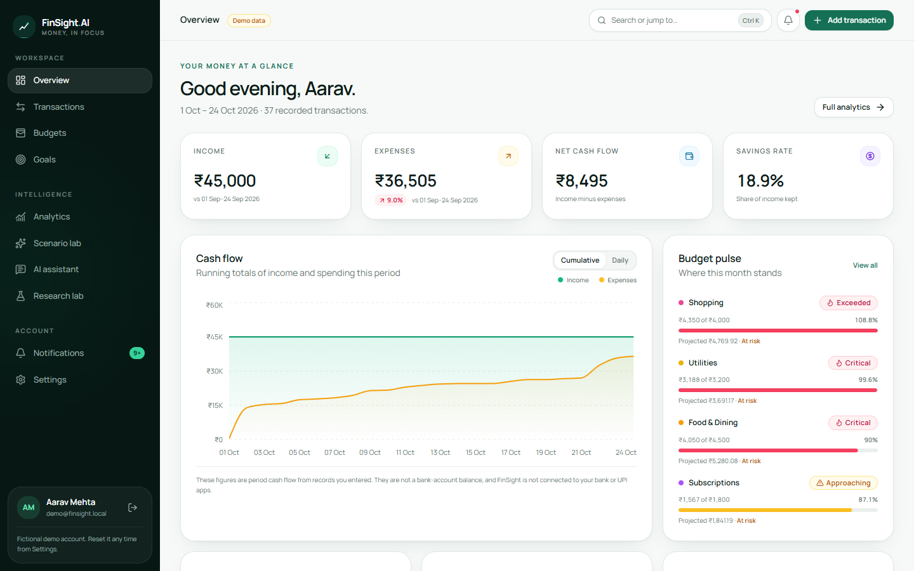
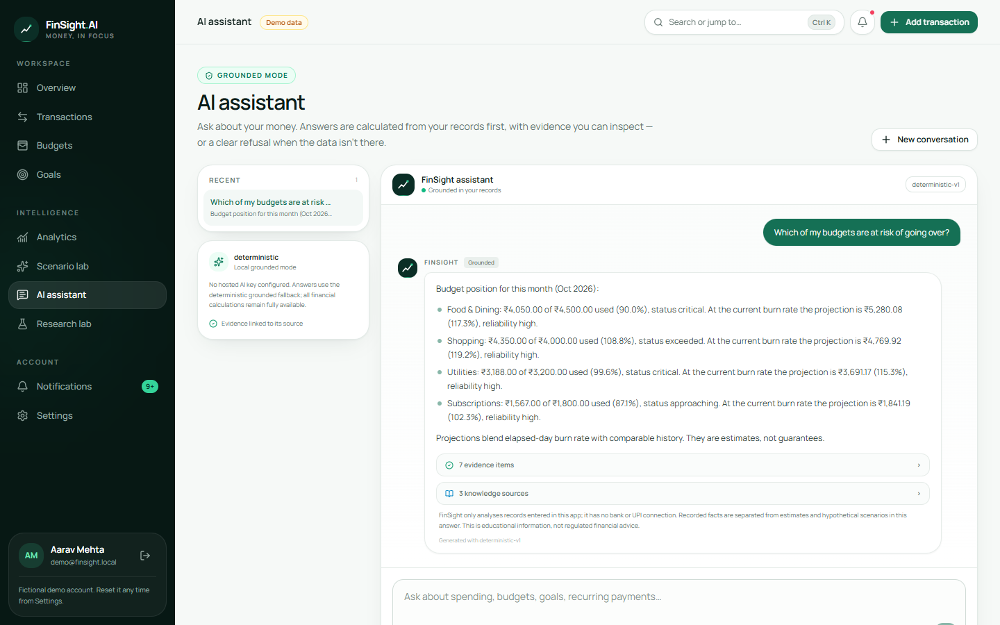
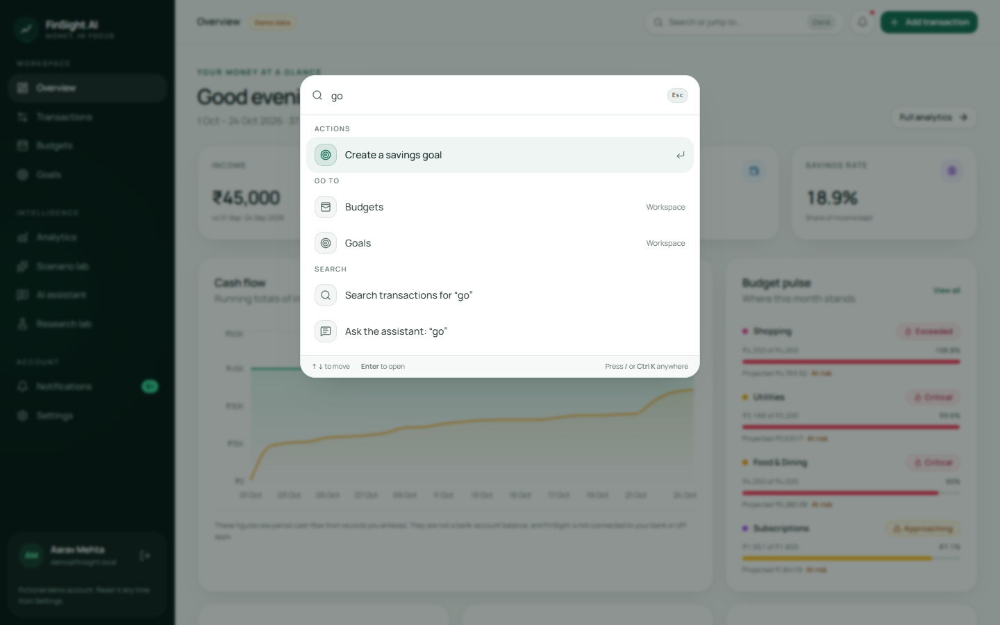
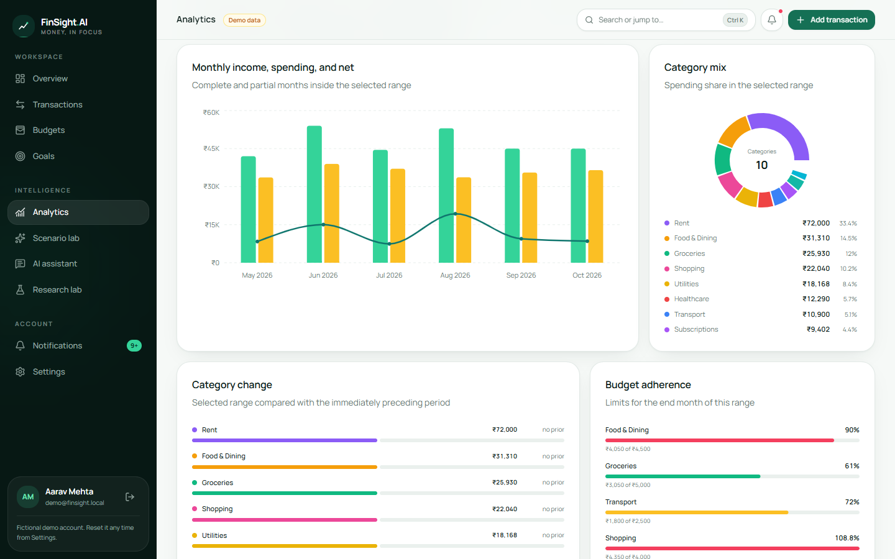
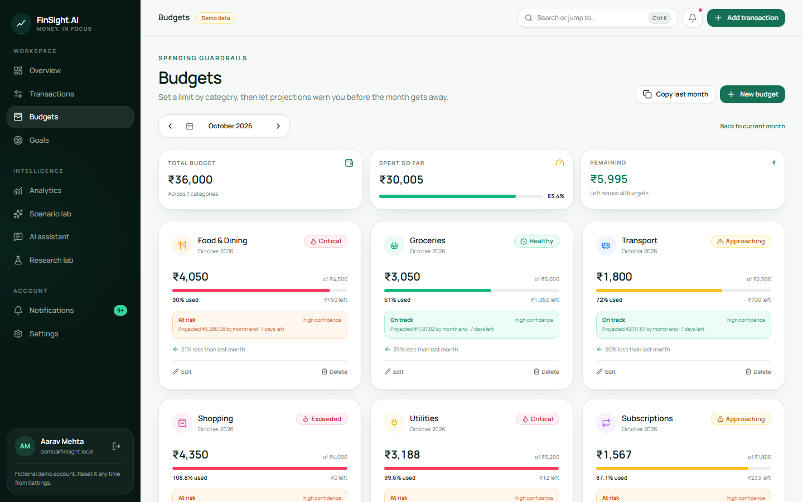
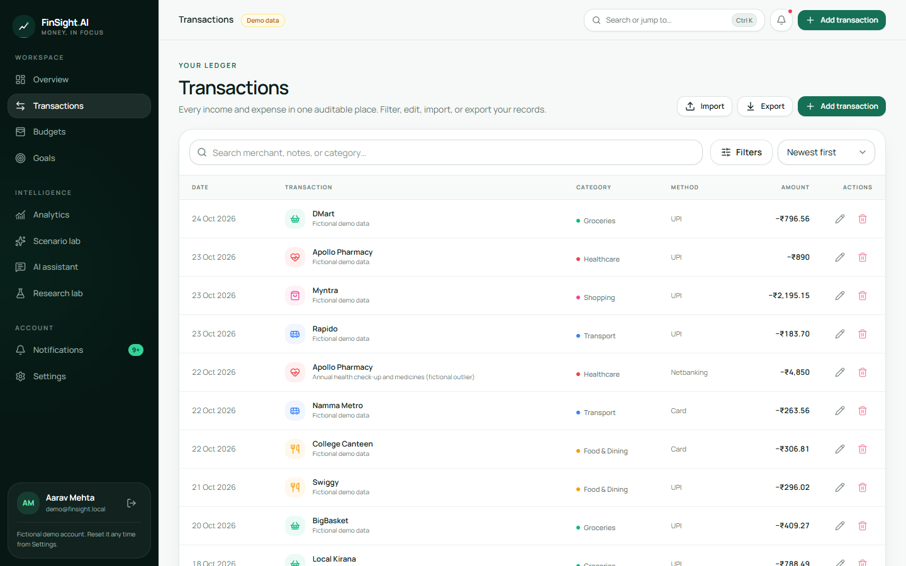
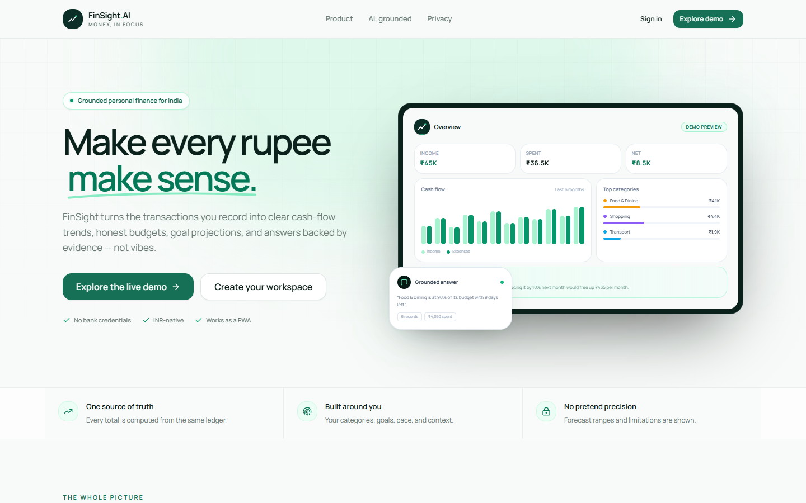
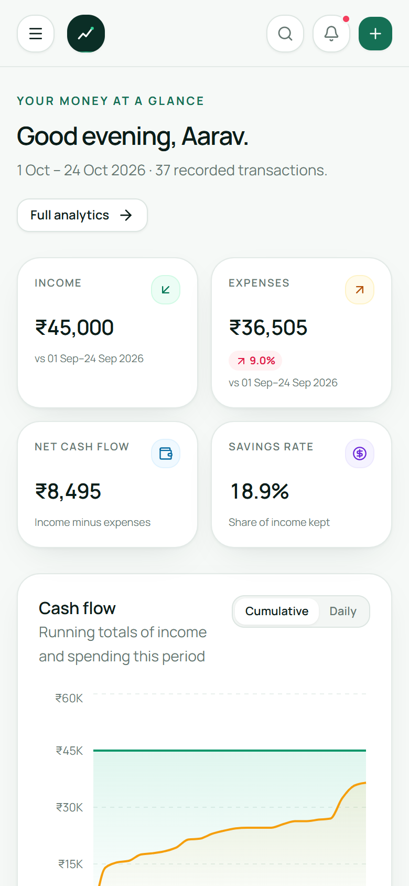
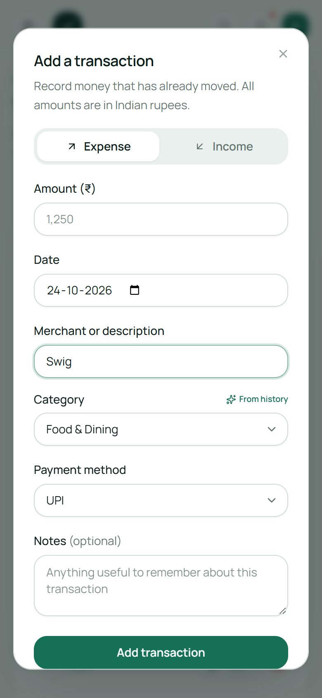
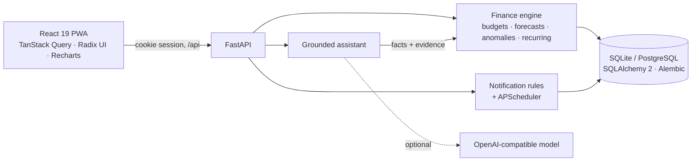

<div align="center">


# FinSight AI

**Make every rupee make sense.**

A personal finance workspace for India: one ledger, honest budgets, goal projections,
and an AI assistant that answers from your own records, with the evidence attached.

[](https://github.com/Sanskar1724/FinSight_AI/actions/workflows/ci.yml)


[Features](#features) · [Run it locally](#run-it-locally) · [How it works](#how-it-works) · [Security](#security--privacy) · [Docs](#documentation)

<br />



</div>

<br />

> [!NOTE]
> FinSight is a demonstration product. The demo workspace uses fictional data, there is no bank or UPI
> connection, and nothing in the app is financial advice.

## Why FinSight

Most budgeting apps either show raw numbers or give AI advice you cannot check. FinSight does neither.

- **One source of truth.** Every total on every page is computed from the same ledger by a deterministic engine.
- **AI with receipts.** The assistant calculates first and writes second. Each answer lists the records and figures it used. When the data isn't there, it says so instead of guessing.
- **Honest forecasts.** Projections come with ranges, reliability levels, and the method behind them.
- **Built for India.** INR-native formatting (₹1,25,000), UPI-first payment methods, and categories that fit everyday spending.

## Features

<table>
  <tr>
    <td width="50%" valign="top">
      <h3>📒 Ledger that thinks ahead</h3>
      <p>Search, filter, sort, import CSVs with a preview, and export. Type a merchant and FinSight fills in the category and payment method from your history.</p>
    </td>
    <td width="50%" valign="top">
      <h3>🎯 Budgets &amp; goals</h3>
      <p>Monthly limits with warning and critical thresholds, burn-rate projections, and copy-from-last-month. Savings goals track your pace and tell you the monthly amount needed.</p>
    </td>
  </tr>
  <tr>
    <td valign="top">
      <h3>📈 Analytics &amp; scenarios</h3>
      <p>Monthly trends, category mix and change, recurring payment detection, unusual-spending indicators, and next-month forecasts with a backtest. The scenario lab answers "what if I cut food by 10%?"</p>
    </td>
    <td valign="top">
      <h3>🤖 Grounded AI assistant</h3>
      <p>Ask in plain English. Answers are calculated from your records with evidence and sources you can open. It works fully offline with the built-in engine, or with any OpenAI-compatible model.</p>
    </td>
  </tr>
  <tr>
    <td valign="top">
      <h3>🔔 Smart notifications</h3>
      <p>Budget thresholds, projected overruns, bill reminders, goal pace, and weekly and monthly summaries. Alerts update as things change, respect quiet hours, and link straight to the fix.</p>
    </td>
    <td valign="top">
      <h3>⌨️ Keyboard-first</h3>
      <p>Press <kbd>Ctrl</kbd> + <kbd>K</kbd> (or <kbd>/</kbd>) anywhere to jump to a page, create a budget or goal, search transactions, or ask the assistant.</p>
    </td>
  </tr>
  <tr>
    <td valign="top">
      <h3>🧪 Research lab</h3>
      <p>Benchmark baseline AI answers against grounded answers on 28 real finance questions using a versioned scoring rubric, then export the results.</p>
    </td>
    <td valign="top">
      <h3>📱 Installable PWA</h3>
      <p>Responsive from 320&nbsp;px up, installable on desktop and mobile, with an auto-updating service worker.</p>
    </td>
  </tr>
</table>

## A closer look

<table>
  <tr>
    <td width="50%"></td>
    <td width="50%"></td>
  </tr>
  <tr>
    <td align="center"><sub><b>Grounded assistant:</b> calculated answers with evidence attached</sub></td>
    <td align="center"><sub><b>Command palette:</b> everything is one keystroke away</sub></td>
  </tr>
  <tr>
    <td></td>
    <td></td>
  </tr>
  <tr>
    <td align="center"><sub><b>Analytics:</b> trends, category mix, and adherence</sub></td>
    <td align="center"><sub><b>Budgets:</b> projections before the month gets away</sub></td>
  </tr>
  <tr>
    <td></td>
    <td></td>
  </tr>
  <tr>
    <td align="center"><sub><b>Ledger:</b> searchable, filterable, exportable</sub></td>
    <td align="center"><sub><b>Landing page</b></sub></td>
  </tr>
</table>

<p align="center">
  
  &nbsp;&nbsp;
  
</p>

## Run it locally

You need **Python 3.12+**, **Node.js 20.19+** (22 recommended), and **Git**.

### 1. Clone

```bash
git clone https://github.com/Sanskar1724/FinSight_AI.git
cd FinSight_AI
```

### 2. Start the API (terminal 1)

<details open>
<summary><b>Windows (PowerShell)</b></summary>

```powershell
cd backend
python -m venv .venv
.\.venv\Scripts\Activate.ps1
pip install -r requirements.txt
python -m uvicorn app.main:app --reload --port 8000
```

If PowerShell blocks activation, run `Set-ExecutionPolicy -Scope Process -ExecutionPolicy Bypass` first.

</details>

<details>
<summary><b>macOS / Linux</b></summary>

```bash
cd backend
python3 -m venv .venv
source .venv/bin/activate
pip install -r requirements.txt
python -m uvicorn app.main:app --reload --port 8000
```

</details>

On first start the API creates the database, applies migrations, and seeds the demo workspace.
Interactive API docs are at <http://127.0.0.1:8000/api/docs>.

### 3. Start the web app (terminal 2)

```bash
cd frontend
npm install
npm run dev
```

### 4. Open it

Go to **<http://localhost:5173>** and click **Explore the live demo**, or sign in with:

| Email | Password |
| --- | --- |
| `demo@finsight.local` | `Demo@12345` |

You can also create your own workspace with **Create your workspace**. To restore the demo data at any time, go to **Settings → Account & privacy → Reset demo data**.

### Run the checks

```bash
# backend (from backend/, with the virtual environment active)
python -m pytest -q

# frontend (from frontend/)
npm run lint
npm run typecheck
npm run build
```

### Production build (single server)

The API can serve the built web app, so one process runs everything:

```bash
cd frontend && npm ci && npm run build
cd ../backend && python -m uvicorn app.main:app --host 0.0.0.0 --port 8000
```

Then open <http://127.0.0.1:8000>. For PostgreSQL, HTTPS cookies, CORS, and separate static hosting, see the [deployment guide](docs/DEPLOYMENT.md).

## How it works



1. **Every figure is computed by the finance engine.** Totals, budgets, forecasts, and anomaly scores use `Decimal` arithmetic over your ledger.
2. **The assistant calculates first.** It detects the intent, period, category, goal, or merchant, pulls the matching facts from the engine, and attaches them as evidence.
3. **Language comes last.** The built-in deterministic writer turns the facts into an answer. If you configure a hosted model, it rewrites those same facts and cannot add figures of its own.

| Layer | Technology |
| --- | --- |
| Frontend | React 19, TypeScript, Vite 7, Tailwind CSS, Radix UI, TanStack Query, React Router 7, Recharts, React Hook Form, Zod |
| Backend | FastAPI, SQLAlchemy 2, Alembic, Pydantic 2, PyJWT, APScheduler |
| Data | SQLite by default, PostgreSQL via `DATABASE_URL` |
| AI | Deterministic grounded engine; optional OpenAI-compatible provider |
| Quality | pytest (77 tests), ESLint, TypeScript strict mode, GitHub Actions CI |

## Security & privacy

- **Isolated accounts.** Every query is scoped to the signed-in user, and other users' records return `404`.
- **Revocable sessions.** HttpOnly, SameSite=Lax cookies (Secure in production). Signing out invalidates every issued session.
- **Strong password storage.** PBKDF2-HMAC-SHA256 with per-user salts and 600,000 iterations.
- **Abuse protection.** Rate-limited sign-in, an Origin check on state-changing requests, and security headers.
- **Safe exports.** CSV exports neutralise spreadsheet formulas.
- **No bank access, ever.** FinSight only sees what you enter or import. With a hosted AI provider configured, only the calculated context for your question is sent to it.

## Configuration

Copy [`backend/.env.example`](backend/.env.example) to `backend/.env`. The settings that matter most:

| Setting | Purpose |
| --- | --- |
| `SECRET_KEY` | Signs session tokens. Use a long random value in production. |
| `DATABASE_URL` | SQLite (default) or PostgreSQL connection string. |
| `COOKIE_SECURE` | Set to `true` behind HTTPS. |
| `CORS_ORIGINS` | Comma-separated allowed frontend origins. |
| `SEED_DEMO_ON_STARTUP` | Create or repair the fictional demo account at startup. |
| `ENABLE_SCHEDULER` | Run the in-process notification scheduler. |
| `AI_PROVIDER`, `AI_API_KEY`, `AI_MODEL` | Optional hosted AI provider. |
| `AI_RATE_LIMIT_PER_HOUR` | Per-user assistant request limit. |

Frontend options are in [`frontend/.env.example`](frontend/.env.example).

## Project structure

```text
backend/
  app/api/          REST routes and auth dependencies
  app/core/         Configuration, security, rate limiting
  app/db/           Engine, sessions, startup migrations
  app/services/     Finance engine, ledger, notifications, AI, research
  alembic/          Database migrations
  tests/            API, finance, and migration tests
frontend/
  src/components/   App shell, command palette, dialogs, UI kit
  src/hooks/        Auth, URL state, and shortcut hooks
  src/lib/          API client, types, formatting, navigation
  src/pages/        Public and app routes
docs/               Architecture, API, research, deployment, screenshots
```

## Documentation

| Guide | What's inside |
| --- | --- |
| [Architecture](docs/ARCHITECTURE.md) | System design, data model, and the grounding pipeline |
| [API reference](docs/API.md) | Every endpoint, filter, and response contract |
| [Research methodology](docs/RESEARCH.md) | Benchmark questions, rubric, and how runs are scored |
| [Deployment](docs/DEPLOYMENT.md) | PostgreSQL, HTTPS, CORS, and hosting options |
| [Upgrade log](UPGRADE_PROGRESS.md) | What changed, how it was verified, and what is still open |

## Roadmap

- [x] Grounded assistant with evidence and safe refusals
- [x] Notification lifecycle with quiet hours and deep links
- [x] Command palette and history-based categorisation
- [x] CI for tests, migrations, lint, typecheck, and build
- [ ] PostgreSQL job and browser end-to-end tests in CI
- [ ] Durable research runs across restarts and workers
- [ ] Zod 4 upgrade ([GHSA-mrhx-c7xc-m3w5](https://github.com/advisories/GHSA-mrhx-c7xc-m3w5))
- [ ] Dark mode

<div align="center">
<br />
<sub>FinSight AI is a planning tool, not a bank or a financial adviser. Your records stay in your own workspace.</sub>
</div>
